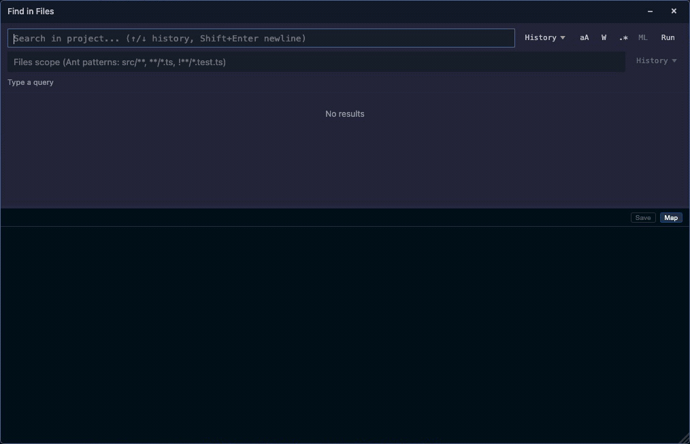
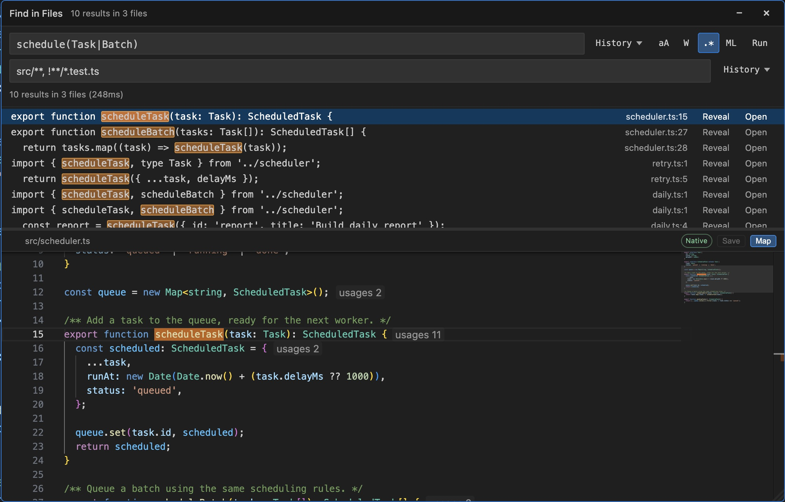
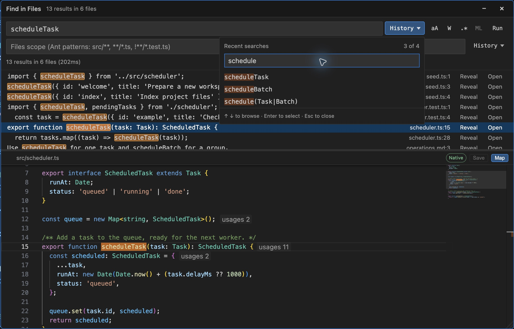
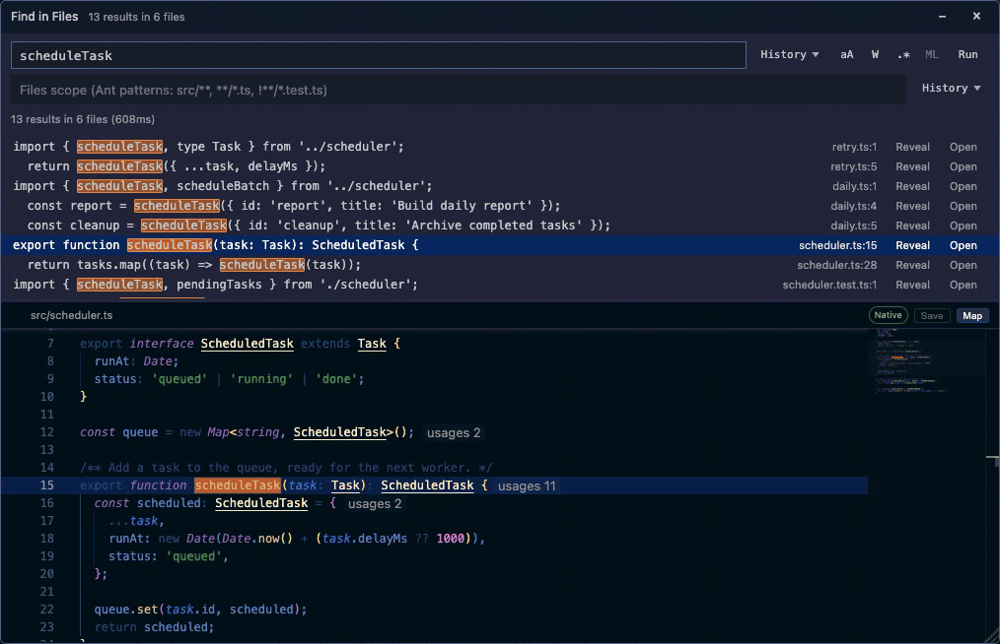
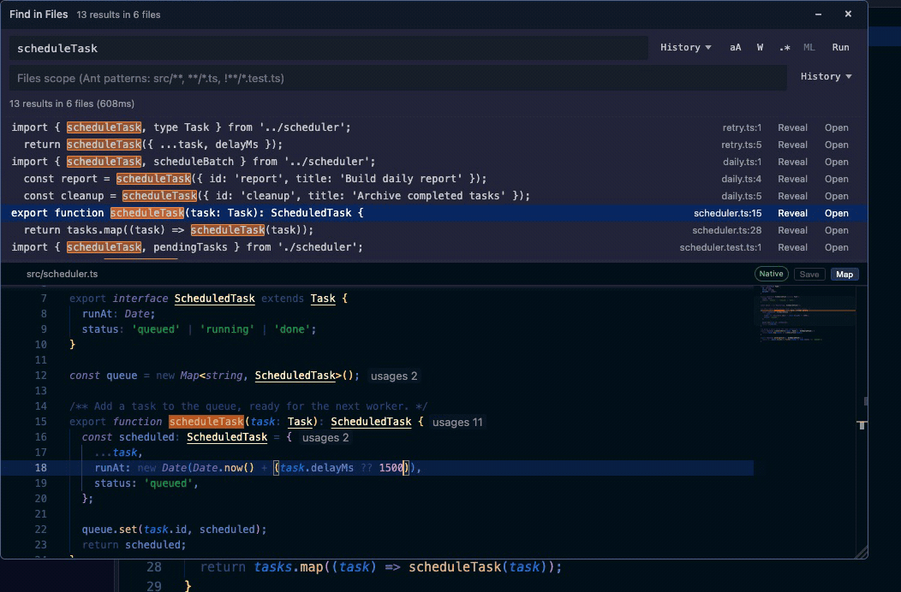

# IntelliJ Styled Search

Search your workspace in a movable IntelliJ IDEA-style panel for VS Code. Narrow the results, read and edit the matching code in place, and follow symbol usages without losing your working context.

Open **IntelliJ Search: Search**, enter a query, and press **Enter** or **Run**. See [keyboard shortcuts](#get-started).

## See it in use

Watch the short demos below. Each has an MP4 link with playback controls and a still image for a motion-free view.

### 1. Find a match and read its context

Search for `scheduleTask`, then select a result to see the surrounding file in the embedded editor. Drag the title bar to move the panel, resize it from the corner, or adjust the results/preview split.



8-second demo · [Play MP4](resources/marketplace/01-search.mp4?raw=true) · [View still](resources/marketplace/01-search.png)

### 2. Focus on the files that matter

Set **Files scope** to `src/**, !**/*.test.ts` to search source files while excluding tests. Combine scope with case-sensitive, whole-word, regex, or multiline search. Each workspace remembers its last scope, including an empty scope.

[](resources/marketplace/02-scope.png)

### 3. Bring back a previous search

Open **History** or press **Alt+H** to filter executed queries and recall one with the keyboard. Files scope has its own workspace history. Selecting a history entry restores it; press **Enter** or **Run** when ready.

[](resources/marketplace/03-history.png)

### 4. Make a small edit right in the preview

Edit the selected file in the preview, then click **Save** or press **Cmd/Ctrl+S**. The modified indicator and enabled Save button show pending changes. Language features such as hover, completion, and navigation use the providers available in your VS Code installation.



7-second demo · [Play MP4](resources/marketplace/04-edit.mp4?raw=true) · [View still](resources/marketplace/04-edit.png)

### 5. Follow a symbol's usages

After building the graph index, click an inline **usages** link beside a symbol to open its references in a usage-results panel. Select a result to preview its calling code. Results show confidence labels. When candidate references are available, **Cand** toggles their visibility; **More** loads the next page when needed.



7-second demo · [Play MP4](resources/marketplace/05-usages.mp4?raw=true) · [View still](resources/marketplace/05-usages.png)

These captures show the running extension in a small TypeScript example project, with idle pauses shortened. Result counts and available language features vary with your workspace.

## Get started

Open a project folder, then run **IntelliJ Search: Search** from the Command Palette or **IntelliJ Search → Search** in the editor context menu. Selected text, or the word at the cursor, prefills the query. Opening the panel does not run the prefilled query by default; press **Enter** or **Run** when ready.

- **macOS:** `Cmd+Shift+Alt+F` searches from the editor; `Cmd+Shift+Alt+P` opens search anywhere.
- **Windows / Linux:** `Ctrl+Shift+Alt+F` searches from the editor; `Ctrl+Shift+Alt+P` opens search anywhere.

## Features

- Movable, resizable search panel with streamed results and an editable Monaco preview.
- Literal, case-sensitive, whole-word, regex, and multiline search; **Shift+Enter** adds a query line. **ML** enables regex dotAll when regex is on.
- Ant-style include/exclude patterns and workspace-specific Files scope persistence.
- Filterable query and scope histories, with **↑/↓** recall and draft restoration. **Alt+↑/↓** navigates results.
- Local Rust search index (`zoekt`), with a `codesearch`/ripgrep fallback while the native runtime or index is unavailable. Saved file changes update the index incrementally.
- Graph-backed usage navigation and optional local Codeidx MCP access for coding agents.

## Index setup

Run **IntelliJ Search: Force Rebuild Search + Graph Index** to prepare or refresh both indexes. Initial searches can use fallback while the native index is unavailable; startup does not build it automatically with the default settings. Use **IntelliJ Search: Show Index Health** to inspect readiness and pending updates.

This extension targets desktop VS Code. The universal release bundles Windows x64 and Apple Silicon macOS native runtimes. Other platforms need a matching runtime or Cargo for a local build; text search can fall back to `codesearch`. Preview language features depend on installed language extensions.

## Commands

The Command Palette exposes these commands under **IntelliJ Search**:

| Command | What it does |
| --- | --- |
| `Search` | Open the panel with the selection or word at the cursor. |
| `Show Candidate Usages` | Show candidate references for the current usage query or symbol. |
| `Toggle Candidate Usages` | Toggle candidate references for the last usage query. |
| `Force Rebuild Search + Graph Index` | Rebuild search, then force a graph rebuild. |
| `Show Index Health` | Write index, freshness, and MCP status to the output log. |
| `Select Search Mode` | Choose an indexed, fallback, symbol, or reference search preset. |
| `Benchmark Against rg` | Compare a query against ripgrep and report timings. |
| `Diagnose Preview Intellisense (probe Pylance for last previewed URI)` | Inspect language-provider behavior for the last previewed file. |
| `Start Codeidx MCP Server` | Start the workspace's local MCP endpoint. |
| `Stop Codeidx MCP Server` | Stop the local endpoint. |
| `Restart Codeidx MCP Server` | Restart the local endpoint. |

## Common settings

All names below start with `intellijStyledSearch.`.

| Setting | Default | Purpose |
| --- | --- | --- |
| `engine` | `zoekt` | Choose the native index or the `codesearch` path. |
| `searchOnOpen` | `false` | Run a prefilled query as soon as the panel opens. |
| `defaultFilesScope` | `""` | Initial Ant patterns when a workspace has no remembered scope. |
| `excludeGlobs` | `[]` | Add patterns to exclude from text search. |
| `searchHistoryLimit` | `100` | Entries retained in each history; `0` disables storage. |
| `maxResults` | `2000` | Match lines per batch; scrolling loads more. |
| `previewLanguageFeatures` | `true` | Relay installed language providers into the preview. |
| `callGraphInlayHints` | `true` | Show inline graph navigation links beside symbols. |
| `mcpAutoStart` | `true` | Start the local MCP endpoint in trusted workspaces. |

See the [search controls and settings guide](docs/search-guide.md) for history shortcuts, scope persistence, and preview configuration.

## Codeidx MCP for coding agents

The extension can expose local text search, symbols, references, and snippets to MCP clients. In trusted workspaces the endpoint starts automatically by default and publishes workspace-local discovery and launcher files under `.codeidx/`. Each VS Code window uses its own port and workspace identity.

See the [MCP setup and tool guide](docs/mcp.md) for client configuration, health checks, and query examples.

## Development

See the [runtime and development guide](docs/development.md), [release instructions](DEPLOY.md), and [Marketplace capture guide](docs/marketplace-captures.md).

```bash
npm install
npm run compile
npm test
```
